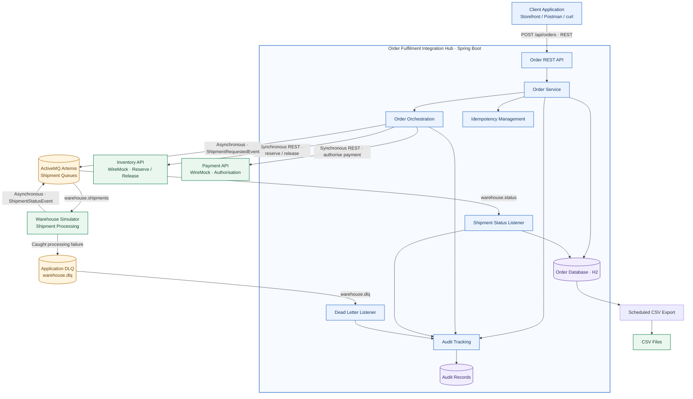
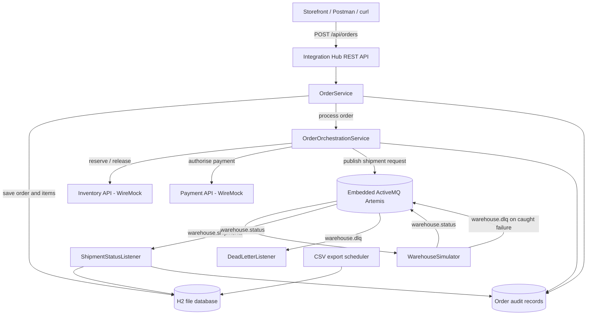
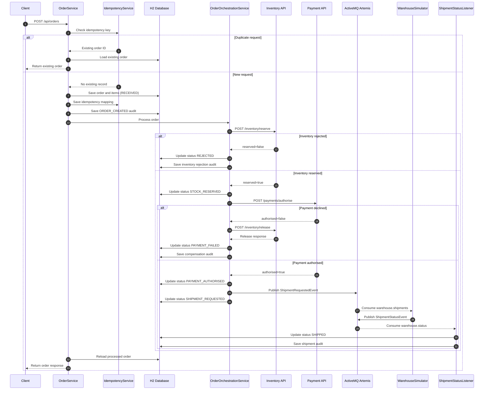
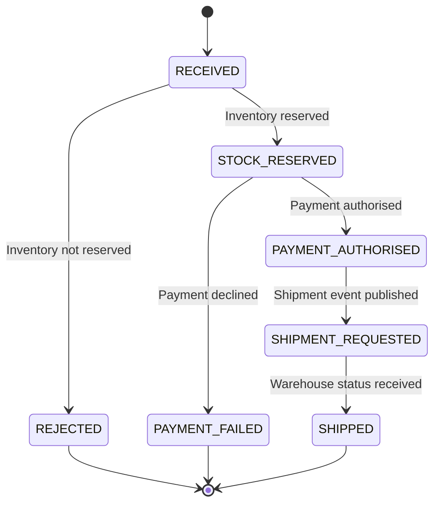
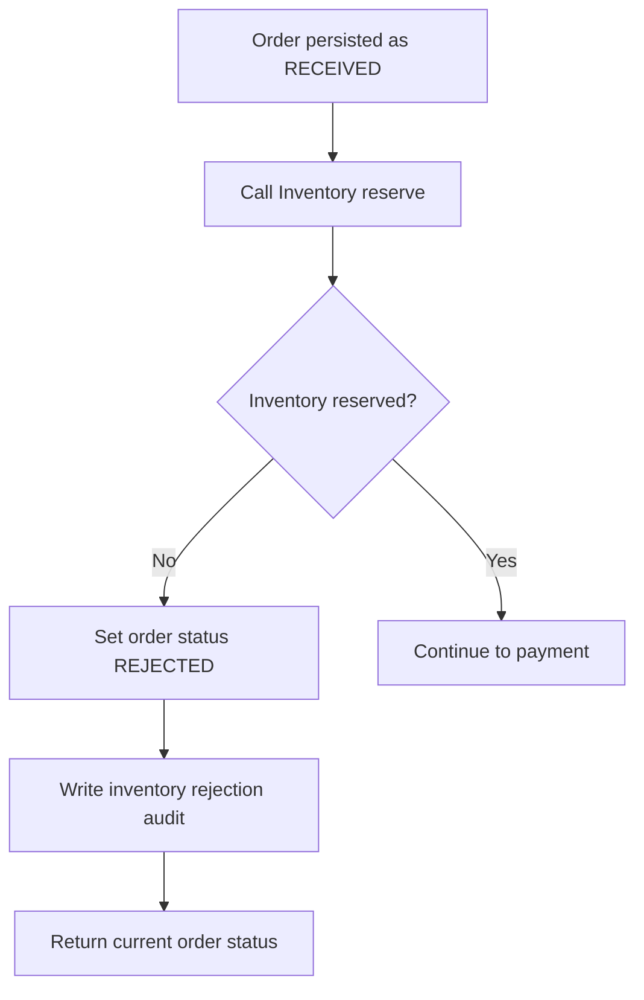
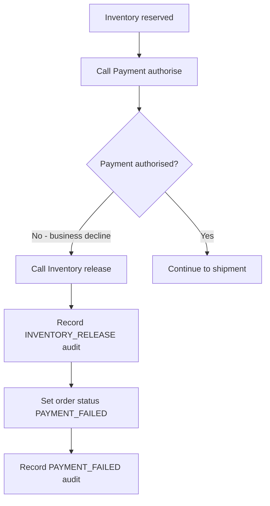
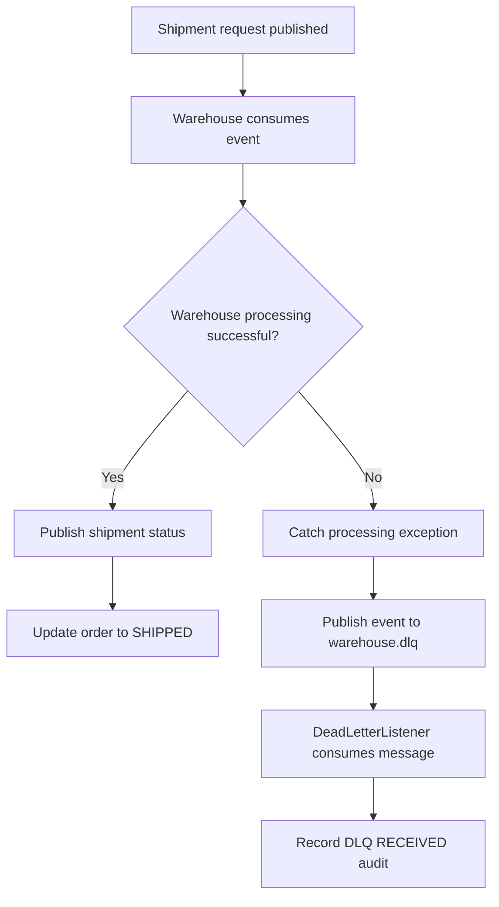
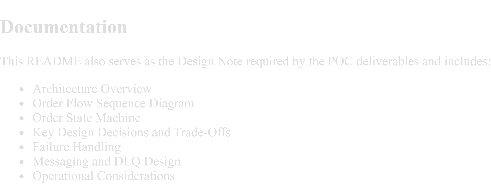

# Order Fulfilment Integration Hub

A Spring Boot application that coordinates order fulfilment across independently simulated Inventory, Payment, and Warehouse systems.

The application demonstrates enterprise integration patterns, including:

- Synchronous REST API orchestration
- Asynchronous messaging using ActiveMQ Artemis
- Saga-style compensation for payment failures
- Idempotency and duplicate request handling
- Audit tracking and correlation IDs
- Resilience4j retry and circuit-breaker patterns
- Warehouse failure handling through a Dead Letter Queue (DLQ)
- Scheduled CSV export of order records

**Implementation note:** This README distinguishes behavior verified in the shared source code and runtime tests from features that still require verification. Known implementation limitations are documented explicitly rather than presented as completed functionality.


## Contents

1. [Overview](#overview)
2. [Technology Stack](#technology-stack)
3. [Architecture](#architecture)
4. [Order Processing Flow](#order-processing-flow)
5. [Order Lifecycle](#order-lifecycle)
6. [Failure and Compensation Scenarios](#failure-and-compensation-scenarios)
7. [Messaging and Dead Letter Handling](#messaging-and-dead-letter-handling)
8. [Idempotency and Audit Trail](#idempotency-and-audit-trail)
9. [Configuration](#configuration)
10. [Prerequisites](#prerequisites)
11. [Run Locally](#run-locally)
12. [API Usage](#api-usage)
13. [WireMock Scenarios](#wiremock-scenarios)
14. [Operational Endpoints](#operational-endpoints)
15. [CSV Export](#csv-export)
16. [Database Schema](#database-schema)
17. [Testing](#testing)
18. [Implementation Notes and Known Gaps](#implementation-notes-and-known-gaps)
19. [Repository](#repository)

## Overview

The **Order Fulfilment Integration Hub** is a Spring Boot-based application that acts as an orchestration layer between a retail storefront and downstream fulfilment systems.

It coordinates the complete order lifecycle by integrating with Inventory, Payment, and Warehouse systems.

For every new order, the application performs the following operations:

1. **Order Creation:** Receives the order request and persists the order details and line items in the H2 database.
2. **Idempotency Check:** Checks whether the incoming idempotency key has already been processed to avoid duplicate order creation.
3. **Inventory Reservation:** Calls the Inventory API through Spring RestClient to reserve the requested stock.
4. **Payment Authorisation:** Calls the Payment API to authorise the order payment. Resilience4j provides retry and circuit-breaker handling.
5. **Compensation:** If payment is declined, the application attempts to release the previously reserved inventory.
6. **Shipment Request:** After successful payment authorisation, publishes a shipment request to an ActiveMQ Artemis queue.
7. **Warehouse Processing:** The Warehouse simulator consumes the shipment request and processes it asynchronously.
8. **Order Status Update:** Receives the warehouse status event and updates the order status to SHIPPED.
9. **Audit Tracking:** Records important processing events in the order audit table.
10. **CSV Export:** Exports eligible order records to CSV files through the scheduled export functionality.

### Integration Approach

The application demonstrates two communication patterns:

- **Synchronous communication:** Spring RestClient is used for Inventory and Payment API calls. The order orchestration waits for these responses.
- **Asynchronous communication:** ActiveMQ Artemis is used for shipment processing and warehouse status updates.

WireMock simulates the external Inventory and Payment APIs, while the Warehouse simulator is implemented using JMS listeners within the application.


## Technology Stack

The application is developed using the following technologies and frameworks.

| Technology | Version / Configuration | Purpose |
|---|---|---|
| Java | 21 | Primary programming language |
| Spring Boot | 3.5.6 | Application framework |
| Maven | 3.x (3.9+ recommended) | Build and dependency management |
| Spring RestClient | Spring Framework | Synchronous REST communication with downstream services |
| Spring Data JPA | Spring Boot managed | Database access and persistence |
| Hibernate | Spring Boot managed | ORM implementation |
| H2 Database | File-based mode | Persistent local database |
| Flyway | Configured version | Database schema migrations |
| ActiveMQ Artemis | Embedded | Asynchronous messaging |
| WireMock | 3.9.1 | Simulation of Inventory and Payment APIs |
| Resilience4j | 2.2.0 | Retry and circuit-breaker functionality |
| Springdoc OpenAPI | 2.8.9 | API documentation and Swagger UI |
| Spring Boot Actuator | Spring Boot managed | Application monitoring and operational endpoints |
| JUnit 5 | Configured dependency | Unit and integration testing |
| Mockito | Configured dependency | Mocking dependencies during tests |
| Awaitility | Configured dependency | Testing asynchronous operations |
| JaCoCo | Configured plugin | Test coverage reporting |

### Development Tools

- IntelliJ IDEA or Visual Studio Code
- Postman or curl for API testing
- Git and GitHub for version control
- H2 Console for local database inspection

## Architecture

The Order Fulfilment Integration Hub acts as the central orchestration layer between the client application and downstream fulfilment systems.

It coordinates synchronous REST communication with Inventory and Payment services and asynchronous messaging with the Warehouse simulator through ActiveMQ Artemis.

## Architecture

### High-level architecture

The diagram below shows the main systems and how an order moves through the Integration Hub. Solid REST interactions are synchronous; the shipment request and shipment status interactions are asynchronous JMS messages.




```text
                         +----------------------+
                         |        Client        |
                         +----------------------+
                                    |
                                    | POST /api/orders
                                    v
              +------------------------------------------+
              |     Order Fulfilment Integration Hub     |
              |------------------------------------------|
              | Order Service                            |
              | Order Orchestration                      |
              | Idempotency Management                   |
              | Audit Tracking                           |
              +------------------------------------------+
                         |                    |
                         |                    |
                         v                    v
              +----------------+   +----------------+
              | Inventory API  |   |  Payment API   |
              |   WireMock     |   |   WireMock     |
              | Reserve/Release|   | Authorisation  |
              +----------------+   +----------------+
                         |                    |
                         +----------+---------+
                                    |
                                    v
                         +----------------------+
                         |   ActiveMQ Artemis   |
                         | Shipment Requested   |
                         |       Queue          |
                         +----------------------+
                                    |
                                    v
                         +----------------------+
                         | Warehouse Simulator  |
                         |----------------------|
                         | Shipment Processing  |
                         | Status Update        |
                         | Application DLQ      |
                         +----------------------+
                                    |
                                    v
                         +----------------------+
                         |  Order Status Update |
                         |----------------------|
                         | SHIPPED              |
                         | Audit                |
                         | CSV Export           |
                         +----------------------+
```

### Architecture Communication Patterns


**Communication patterns**

- **Synchronous:** The Integration Hub calls the Inventory and Payment APIs over REST and waits for their responses.
- **Asynchronous:** After successful payment, the hub publishes a shipment request to ActiveMQ Artemis. The Warehouse Simulator processes it and publishes a shipment status event.
- **Failure handling:** The Warehouse Simulator routes caught processing failures to the application-managed `warehouse.dlq` queue, where the dead-letter listener records an audit entry.
- **Persistence and reporting:** Order and audit information is stored in H2. The scheduled export process reads eligible orders and writes CSV files; the exporter implementation and schedule remain subject to the verification note below.

### Implementation-level component architecture

The following diagram shows the application classes and persistence interactions at a more detailed level.



**1. Synchronous REST communication**

- The Order Orchestration Service calls the Inventory API to reserve or release stock.
- The Payment Client calls the Payment API to authorise payment.
- Spring RestClient is used for downstream HTTP communication.
- The orchestration flow waits for the downstream response before continuing.

**2. Asynchronous messaging**

- After successful payment authorisation, the application publishes a shipment request to `warehouse.shipments`.
- The Warehouse Simulator consumes and processes the shipment request.
- It publishes the shipment status to `warehouse.status`.
- The ShipmentStatusListener consumes the status event and updates the order.
- Warehouse processing failures are explicitly routed to `warehouse.dlq` by the application.

### Component Responsibilities

| Component | Responsibility |
|---|---|
| OrderService | Checks the idempotency key, creates and persists the order and items, starts orchestration, and builds the create-order response. |
| OrderOrchestrationService | Coordinates inventory reservation, payment authorisation, compensation, and shipment publication. |
| InventoryClient | Calls Inventory reserve and release endpoints using Spring RestClient. |
| PaymentClient | Calls the Payment authorisation endpoint using Spring RestClient with Resilience4j retry and circuit-breaker annotations. |
| IdempotencyService | Stores and retrieves the order associated with an idempotency key. |
| AuditService | Records processing steps, outcomes, correlation values, and timestamps in the audit table. |
| ShipmentPublisher | Publishes shipment requests and application-routed failure messages to Artemis queues. |
| WarehouseSimulator | Consumes shipment requests, simulates warehouse processing, and publishes shipment status or DLQ messages. |
| ShipmentStatusListener | Consumes shipment status messages and updates the corresponding order to SHIPPED. |
| DeadLetterListener | Consumes messages from `warehouse.dlq` and records a DLQ audit entry. |

### Downstream System Simulation

The Inventory and Payment services are simulated independently using WireMock 3.9.1.

The Warehouse system is simulated inside the Spring Boot application using JMS listeners and ActiveMQ Artemis.

This setup allows different fulfilment scenarios to be tested locally without depending on real external systems.

## Order Processing Flow

The Order Fulfilment Integration Hub follows a combination of synchronous REST orchestration and asynchronous messaging to process customer orders.

The order creation and downstream Inventory and Payment calls are synchronous. Shipment processing is asynchronous and is handled by the Warehouse Simulator through ActiveMQ Artemis.

### Order Processing Sequence Diagram



### Step-by-Step Processing

**Step 1: Receive Order Request**

The client sends a new order request to:

`POST /api/orders`

The request contains customer details, order items, quantities, prices, total amount, and currency.

**Step 2: Idempotency Validation**

`OrderService` calls `IdempotencyService` to check whether the supplied idempotency key already exists.

- If the key exists, the previously associated order is retrieved and returned.
- If the key is new, order processing continues.

**Step 3: Create and Persist Order**

For a new request, `OrderService`:

- Generates a unique order ID.
- Creates an order with status `RECEIVED`.
- Attaches the requested order items.
- Saves the order and its items.
- Saves the idempotency mapping.
- Records the `ORDER_CREATED` audit event.

**Step 4: Reserve Inventory**

`OrderOrchestrationService` calls `InventoryClient`.

The Inventory API receives the request through Spring RestClient.

- If inventory is unavailable, the order status becomes `REJECTED`.
- If inventory is available, the order status becomes `STOCK_RESERVED`.

**Step 5: Authorise Payment**

After successful inventory reservation, `PaymentClient` calls the Payment API.

The payment request contains the order ID, customer ID, and total amount.

Resilience4j retry and circuit-breaker mechanisms are configured around the payment operation.

**Step 6: Handle Payment Failure**

If payment is declined, the application attempts to release the reserved inventory.

The order is updated to `PAYMENT_FAILED`, and the corresponding audit events are recorded.

Technical payment failures, such as HTTP timeouts, are handled separately from genuine business payment declines.

**Step 7: Publish Shipment Request**

After successful payment authorisation:

- The order status becomes `PAYMENT_AUTHORISED`.
- A `ShipmentRequestedEvent` is created.
- The event is published to `warehouse.shipments`.
- The order status becomes `SHIPMENT_REQUESTED`.

**Step 8: Warehouse Processing**

The Warehouse Simulator consumes the shipment request asynchronously.

After successful processing, it publishes a `ShipmentStatusEvent` to `warehouse.status`.

**Step 9: Update Shipment Status**

`ShipmentStatusListener` consumes the warehouse status event.

The corresponding order is updated to `SHIPPED`, and the shipment processing audit event is recorded.

**Step 10: Return Order Response**

After synchronous orchestration finishes, `OrderService` reloads the order and returns the response.

For a successful payment, the immediate response normally contains `SHIPMENT_REQUESTED`. The warehouse processing happens asynchronously, so the status changes to `SHIPPED` later.

Use `GET /api/orders/{orderId}` to retrieve the latest order status.

## Order Lifecycle

The order lifecycle represents the different stages an order passes through during fulfilment. The application maintains the current order status in the database and updates it as each processing stage completes.

### Order Lifecycle Diagram



### Order Status Description

| Status | Description |
|---|---|
| `RECEIVED` | The order request has been accepted by the application and persisted in the database. |
| `STOCK_RESERVED` | Inventory has successfully reserved the requested stock. |
| `REJECTED` | The Inventory API could not reserve the requested stock. |
| `PAYMENT_AUTHORISED` | The Payment API successfully authorised the payment. |
| `PAYMENT_FAILED` | The Payment API returned a business decline. The application attempts to release the reserved inventory. |
| `SHIPMENT_REQUESTED` | The shipment request was published to the ActiveMQ Artemis warehouse queue. |
| `SHIPPED` | The warehouse status event was consumed and the order was updated successfully. |

### Successful Order Lifecycle

For a successful order, the normal status progression is:

```text
RECEIVED
    |
    v
STOCK_RESERVED
    |
    v
PAYMENT_AUTHORISED
    |
    v
SHIPMENT_REQUESTED
    |
    v
SHIPPED
```

### Inventory Rejection Lifecycle

When the Inventory API cannot reserve the requested stock:

```text
RECEIVED
    |
    v
REJECTED
```

Payment authorisation is not initiated.

### Payment Decline Lifecycle

When the Payment API returns a business decline:

```text
RECEIVED
    |
    v
STOCK_RESERVED
    |
    v
INVENTORY_RELEASE (compensation action)
    |
    v
PAYMENT_FAILED
```

The inventory release is a compensation action recorded in the audit trail. It is not a separate order status.

### Asynchronous Shipment Processing

`SHIPMENT_REQUESTED` is an intermediate order status.

After successful payment authorisation, the application publishes the shipment event to ActiveMQ Artemis. The Warehouse Simulator processes the event asynchronously.

Once the ShipmentStatusListener consumes the successful warehouse status event, the order is updated to `SHIPPED`.

**Note:** A warehouse processing failure is currently recorded through the application-managed Dead Letter Queue (DLQ) audit flow. The supplied implementation does not introduce a separate warehouse-failure order status.

## Failure and Compensation Scenarios

The application handles downstream failures using business validation, compensating actions, resilience mechanisms, and asynchronous failure routing.

### 1. Insufficient Inventory



The application checks the `InventoryResponse.reserved()` value.

When it is `false`:

- The order status is updated to `REJECTED`.
- An inventory rejection audit entry is recorded.
- Payment authorisation is not initiated.

### 2. Payment Decline and Inventory Compensation



When the Payment API returns a business decline (`authorised=false`), the orchestration service attempts to release the previously reserved inventory.

The application then:

- Calls the Inventory release endpoint.
- Records the inventory compensation result.
- Updates the order status to `PAYMENT_FAILED`.
- Records the payment failure audit entry.

This is a Saga-style compensation approach. The application does not use a distributed database transaction across Inventory and Payment systems.

### 3. Payment Timeout and Downstream Exception

The Payment API is called through Spring `RestClient`. The PaymentClient is configured with Resilience4j `@Retry` and `@CircuitBreaker` annotations.

For the `CUST-SLOW` scenario, the WireMock mapping delays the payment response by 15 seconds.

**Observed timeout behaviour:**

1. The HTTP client request times out after approximately 5 seconds.
2. The timeout is raised as a `ResourceAccessException`, wrapping a `java.net.http.HttpTimeoutException`.
3. Resilience4j retry handling is triggered.
4. The configured retry policy allows a maximum of 3 attempts with a 1-second wait between attempts.
5. Two attempts were visible in the shared execution logs; the third attempt has not yet been independently verified.
6. The PaymentClient fallback logs and rethrows the technical runtime exception rather than converting it into a business payment decline.
7. The global exception handler maps the downstream timeout to HTTP 503 Service Unavailable.

**Example HTTP response:**

```json
{
  "type": "about:blank",
  "title": "Downstream Service Unavailable",
  "status": 503,
  "detail": "A downstream service is currently unavailable. Please try again later.",
  "instance": "/api/orders",
  "correlationId": "0484f134-09dd-46e9-822e-fdad01e69e1f"
}
```

**Important transaction consideration:**

The order creation flow uses a database transaction. When the technical runtime exception escapes the transactional service, the local database transaction is rolled back by default.

However, database rollback does not automatically reverse external REST operations. An inventory reservation may therefore remain active even though the order transaction was rolled back.

A payment timeout also does not prove that the payment provider did not authorise the transaction. The provider may have processed the request even if the response was not received.

Payment idempotency, status reconciliation, and compensation handling are important considerations for this scenario.

**TimeLimiter clarification:** The synchronous `RestClient` timeout is enforced through the HTTP client/request-factory configuration. A Resilience4j TimeLimiter YAML property alone does not apply a timeout to a synchronous RestClient call.

### 4. Warehouse Processing Failure and Dead Letter Queue



The Warehouse Simulator checks for the special customer ID `CUST-WAREHOUSE-FAIL`.

For this customer:

- The simulator throws a simulated processing exception.
- The exception is caught by the application.
- The original shipment event is explicitly published to `warehouse.dlq`.
- The `DeadLetterListener` consumes the message.
- A `DLQ / RECEIVED` audit entry is recorded.

The order remains in `SHIPMENT_REQUESTED` in the supplied implementation. There is no separate warehouse-failure order status.

**Implementation note:** This is application-managed DLQ routing. It does not demonstrate Artemis broker-managed redelivery or a broker-configured dead-letter address policy.


## Messaging and dead-letter handling

The Integration Hub uses asynchronous JMS messaging to coordinate shipment processing between the Integration Hub and the Warehouse Simulator.

### Queue overview

| Queue | Direction | Purpose |
|---|---|---|
| `warehouse.shipments` | Hub → Warehouse Simulator | Carries `ShipmentRequestedEvent` messages for shipment processing. |
| `warehouse.status` | Warehouse Simulator → Hub | Carries `ShipmentStatusEvent` messages after warehouse processing. |
| `warehouse.dlq` | Warehouse Simulator → DLQ Listener | Receives shipment events that the simulator cannot process. |

### Shipment message flow

1. After successful inventory reservation and payment authorisation, the order reaches `SHIPMENT_REQUESTED`.
2. The Integration Hub uses `JmsTemplate.convertAndSend` to publish a `ShipmentRequestedEvent` to `warehouse.shipments`.
3. `WarehouseSimulator` listens to `warehouse.shipments` and processes the shipment asynchronously.
4. After successful processing, the simulator publishes a `ShipmentStatusEvent` to `warehouse.status`.
5. `ShipmentStatusListener` consumes the status event and updates the corresponding order to `SHIPPED`.

Because shipment processing is asynchronous, the initial order API response can return while the order is still in `SHIPMENT_REQUESTED`. The status changes to `SHIPPED` after the warehouse simulator processes the message and the status listener updates the order.

### Dead-letter handling

The POC includes an application-managed dead-letter flow for warehouse processing failures.

For the simulated failure scenario using customer ID `CUST-WAREHOUSE-FAIL`:

1. The order successfully reaches `SHIPMENT_REQUESTED`.
2. `WarehouseSimulator` detects the configured failure scenario and simulates a processing exception.
3. The simulator catches the exception and explicitly publishes the failed shipment event to `warehouse.dlq`.
4. `DeadLetterListener` consumes the event from `warehouse.dlq`.
5. The listener records a `DLQ / RECEIVED` audit entry.

**Implementation note:** The supplied code explicitly publishes failed events to `warehouse.dlq` from the application. This is not evidence of broker-managed dead-letter routing, automatic broker redelivery, or a configured Artemis retry policy.

The current implementation also leaves the order in `SHIPMENT_REQUESTED` after this simulated warehouse failure; it does not transition the order to a separate warehouse-failure status.

## Idempotency and audit trail

The Integration Hub implements idempotency to prevent duplicate order processing and maintains an audit trail to record important order-processing activities.

### Idempotency

The `IdempotencyService` stores a mapping between an `Idempotency-Key` and an order ID in the `idempotency_record` table.

The processing flow is:

1. The client submits an order with an `Idempotency-Key` header.
2. The service checks whether the key already exists.
3. If the key is new, the service creates the order and saves the key-to-order mapping.
4. If the same key is submitted again, the service retrieves and returns the original order.
5. The repeated request does not execute inventory reservation, payment authorisation, or shipment orchestration again.

This helps protect the application against duplicate order creation when clients retry requests due to network failures or uncertain responses.

**Implementation note:** The current implementation performs a lookup followed by a save. Concurrent requests using the same new key could both pass the initial lookup. A database uniqueness constraint on the idempotency key, together with appropriate duplicate-key conflict handling, should be considered to guarantee race-safe idempotency.

### Audit trail

The `AuditService` persists audit records in the `order_audit` table to maintain a history of important processing activities.

Each audit record contains:

- Order ID
- Processing step
- Outcome
- Correlation value
- Creation timestamp

Examples of processing steps recorded by the shared code include:

| Audit step | Purpose |
|---|---|
| `ORDER_CREATED` | Records order creation. |
| `INVENTORY` | Records the inventory reservation result. |
| `PAYMENT` | Records the payment authorisation result. |
| `INVENTORY_RELEASE` | Records the inventory compensation attempt. |
| `SHIPMENT` | Records shipment processing activity. |
| `DLQ` | Records dead-letter handling activity. |

The audit history helps developers and operators understand how an order moved through the fulfilment workflow and identify where a failure occurred.

### Correlation ID considerations

The audit entity contains a field named `correlationId`. However, in the shared code, calls to `AuditService.audit` pass values such as `LOCAL` and `ARTEMIS` as the fourth argument.

These values currently identify the processing source rather than the actual request correlation ID.

Therefore, the current implementation should not be described as providing complete end-to-end correlation ID propagation across REST calls, JMS messages, and audit records. This can be improved by consistently passing the original correlation ID through the request, service, downstream calls, and messaging events.


## Configuration

The Integration Hub uses Spring Boot's externalised configuration through `application.yml`.

The following table highlights the important configuration properties used by the application.

### Database configuration

| Property | Value | Purpose |
|---|---|---|
| `spring.datasource.url` | `jdbc:h2:file:./data/orderdb;MODE=PostgreSQL` | Configures the persistent local H2 database using PostgreSQL compatibility mode. |
| `spring.jpa.hibernate.ddl-auto` | `validate` | Validates the database schema against the JPA entities. |
| `spring.flyway.enabled` | `true` | Enables Flyway database migrations. |

### Messaging configuration

| Property | Value | Purpose |
|---|---|---|
| `spring.artemis.mode` | `embedded` | Configures an embedded ActiveMQ Artemis broker. |

The application uses JMS messaging to communicate with the Warehouse Simulator through the shipment and status queues.

### Downstream service configuration

| Property | Value | Purpose |
|---|---|---|
| `hub.inventory-url` | `http://localhost:8089` | Inventory WireMock base URL. |
| `hub.payment-url` | `http://localhost:8089` | Payment WireMock base URL. |
| `hub.api-key` | `${HUB_API_KEY:local-dev-key}` | API key configuration with an environment variable and local default. |

The Inventory and Payment clients use WireMock to simulate downstream service responses during local development.

### Resilience4j configuration

The following properties configure retry and circuit-breaker behavior for the Payment client.

| Property | Value | Purpose |
|---|---|---|
| `resilience4j.retry.instances.payment.max-attempts` | `3` | Configured maximum number of payment attempts. |
| `resilience4j.retry.instances.payment.wait-duration` | `1s` | Configured wait duration between retry attempts. |
| `resilience4j.circuitbreaker.instances.payment.sliding-window-size` | `5` | Number of calls considered in the sliding window. |
| `resilience4j.circuitbreaker.instances.payment.minimum-number-of-calls` | `3` | Minimum calls before failure-rate evaluation. |
| `resilience4j.circuitbreaker.instances.payment.failure-rate-threshold` | `50` | Failure-rate percentage that can open the circuit breaker. |
| `resilience4j.circuitbreaker.instances.payment.wait-duration-in-open-state` | `30s` | Duration the circuit breaker remains open before it can transition to half-open. |

The retry and circuit-breaker annotations are applied to the Payment client. Actual retry attempts and circuit-breaker transitions depend on the exceptions returned by the downstream call and the configured HTTP client behavior.

### Environment-specific configuration

The original POC describes separate local, warehouse, and test profiles, along with a three-second payment TimeLimiter, outbound correlation propagation, and environment-specific configuration.

However, the profile-specific implementations and complete configuration were not present in the source files shared so far. These features should be verified against the actual application configuration before being documented as implemented behavior.

**Configuration recommendation:** For deployments outside local development, provide sensitive values such as API keys through environment variables or a secure configuration provider instead of committing secrets to source control.


## Prerequisites

Before running the Order Fulfilment Integration Hub locally, ensure the following software is installed.

### Required software

| Software | Version | Purpose |
|---|---|---|
| Java Development Kit (JDK) | 21 | Compiles and runs the Spring Boot application. |
| Apache Maven | 3.9 or later | Builds the project and manages dependencies. |
| Git | Latest stable version | Clones and manages the source repository. |
| WireMock Standalone | 3.9.1 | Simulates Inventory and Payment downstream services. |

### Optional tools

| Tool | Purpose |
|---|---|
| Postman | Sends HTTP requests to the Integration Hub APIs. |
| curl | Tests REST endpoints from the command line. |
| IntelliJ IDEA / Eclipse / VS Code | Opens, develops, and debugs the application. |

### Verify installations

Open a terminal and execute the following commands:

```bash
java -version
mvn -version
git --version
```

Confirm that Java 21 and Maven 3.9 or later are available before proceeding.

**Note:** WireMock Standalone 3.9.1 is required for the local downstream service simulation. The application uses an embedded ActiveMQ Artemis broker, so a separate Artemis installation is not required for the described local setup.


## Run locally

Follow these steps to clone, configure, and run the Order Fulfilment Integration Hub on your local machine.

### 1. Clone the repository

Open a terminal and execute:

```bash
git clone https://github.com/manoj0708r/integration-hub.git
cd integration-hub
```

### 2. Start WireMock

WireMock simulates the external Inventory and Payment services.

Download the WireMock Standalone 3.9.1 JAR and place it in the project root directory.

Start WireMock using:

```bash
java -jar wiremock-standalone-3.9.1.jar --port 8089 --root-dir ./wiremock
```

WireMock should now be available at:

```text
http://localhost:8089
```

The mapping files under `wiremock/mappings` define the simulated Inventory and Payment responses.

Keep this terminal running.

### 3. Start the Integration Hub

Open a second terminal, navigate to the project root directory, and execute:

```bash
mvn clean spring-boot:run
```

Maven builds the project and starts the Spring Boot application.

The Integration Hub should be available at:

```text
http://localhost:8080
```

Keep this terminal running as well.

### 4. Access developer consoles and operational endpoints

Once the application has started successfully, the following resources are available.

| Resource | URL |
|---|---|
| Swagger UI | http://localhost:8080/swagger-ui/index.html |
| H2 Console | http://localhost:8080/h2-console |
| Actuator Health | http://localhost:8080/actuator/health |
| Actuator Metrics | http://localhost:8080/actuator/metrics |
| Actuator Circuit Breakers | http://localhost:8080/actuator/circuitbreakers |

### 5. H2 database connection details

Use the following connection details when accessing the H2 Console.

```text
JDBC URL: jdbc:h2:file:./data/orderdb;MODE=PostgreSQL
Username: sa
Password: (empty)
```

The database is file-based, so local application data is persisted between application restarts.

### Startup checklist

Before testing the order APIs, confirm:

- WireMock is running on port `8089`.
- The Spring Boot application is running on port `8080`.
- Flyway migrations complete successfully during application startup.
- The application reports a healthy status through the Actuator health endpoint.

**Note:** The Integration Hub uses an embedded ActiveMQ Artemis broker. You do not need to start a separate Artemis server for this local setup.

## API usage and test scenarios

The Order Fulfilment Integration Hub exposes REST endpoints to create orders and retrieve existing order details.

The following examples demonstrate the main order-processing and failure-handling scenarios supported by the POC.

### Available endpoints

| Method | Endpoint | Purpose |
|---|---|---|
| `POST` | `/api/orders` | Submits a new order for fulfilment processing. |
| `GET` | `/api/orders/{id}` | Retrieves an existing order and its audit history. |

### Request headers

The following headers are used when submitting an order.

| Header | Purpose | Example |
|---|---|---|
| `Content-Type` | Specifies the request body format. | `application/json` |
| `X-API-Key` | Supplies the configured API key. | `local-dev-key` |
| `Idempotency-Key` | Prevents duplicate order processing when the same request is retried. | `HAPPY-001` |
| `X-Correlation-Id` | Supplies an optional correlation identifier, if supported by the API layer. | `CORR-HAPPY-001` |

**Base URL:** `http://localhost:8080`

### 1. Happy path — Successful order processing

**Scenario:** Inventory reservation and payment authorisation succeed. The shipment is published for asynchronous warehouse processing.

**Request headers**

```http
POST http://localhost:8080/api/orders
Content-Type: application/json
X-API-Key: local-dev-key
Idempotency-Key: HAPPY-001
X-Correlation-Id: CORR-HAPPY-001
```

**Request payload**

```json
{
  "customerId": "CUST-1001",
  "items": [
    {
      "sku": "SKU-IPHONE-16",
      "quantity": 1,
      "unitPrice": 85000
    }
  ],
  "totalAmount": 85000,
  "currency": "INR"
}
```

**Expected order progression**

```text
RECEIVED
    |
    v
STOCK_RESERVED
    |
    v
PAYMENT_AUTHORISED
    |
    v
SHIPMENT_REQUESTED
    |
    v
SHIPPED
```

**Expected result:**

- Inventory reservation succeeds.
- Payment authorisation succeeds.
- Shipment request is published to `warehouse.shipments`.
- Warehouse simulator processes the shipment.
- The status listener updates the order to `SHIPPED`.

The initial API response will generally show `SHIPMENT_REQUESTED`. The final `SHIPPED` status is updated asynchronously.

### 2. Inventory rejection

**Scenario:** The requested SKU is unavailable, so the order is rejected before payment processing.

**Request headers**

```http
POST http://localhost:8080/api/orders
Content-Type: application/json
X-API-Key: local-dev-key
Idempotency-Key: INVENTORY-REJECT-001
X-Correlation-Id: CORR-INVENTORY-001
```

**Request payload**

```json
{
  "customerId": "CUST-1002",
  "items": [
    {
      "sku": "SKU-OUT-OF-STOCK",
      "quantity": 1,
      "unitPrice": 85000
    }
  ],
  "totalAmount": 85000,
  "currency": "INR"
}
```

**Expected order progression**

```text
RECEIVED
    |
    v
REJECTED
```

**Expected result:**

- Inventory service returns `reserved: false`.
- The order status becomes `REJECTED`.
- Payment authorisation is not invoked.
- No shipment request is published.

### 3. Payment failure and inventory compensation

**Scenario:** Inventory reservation succeeds, but the payment service returns a business-level payment decline.

**Request headers**

```http
POST http://localhost:8080/api/orders
Content-Type: application/json
X-API-Key: local-dev-key
Idempotency-Key: PAYMENT-FAIL-001
X-Correlation-Id: CORR-PAYMENT-001
```

**Request payload**

```json
{
  "customerId": "CUST-FAIL",
  "items": [
    {
      "sku": "SKU-IPHONE-16",
      "quantity": 1,
      "unitPrice": 85000
    }
  ],
  "totalAmount": 85000,
  "currency": "INR"
}
```

**Expected order progression**

```text
RECEIVED
    |
    v
STOCK_RESERVED
    |
    v
INVENTORY_RELEASE
    |
    v
PAYMENT_FAILED
```

**Expected result:**

- Inventory reservation succeeds.
- Payment service returns `authorised: false`.
- The Integration Hub attempts to release the reserved inventory.
- The order status becomes `PAYMENT_FAILED`.
- Audit records capture the payment failure and inventory release attempt.

This scenario demonstrates Saga-style compensation for a business-level payment failure.

### 4. Payment timeout and resilience handling

**Scenario:** The payment service responds slowly, causing the configured HTTP client timeout and exercising the Payment client's resilience controls.

**Request headers**

```http
POST http://localhost:8080/api/orders
Content-Type: application/json
X-API-Key: local-dev-key
Idempotency-Key: PAYMENT-TIMEOUT-001
X-Correlation-Id: CORR-PAYMENT-TIMEOUT-001
```

**Request payload**

```json
{
  "customerId": "CUST-SLOW",
  "items": [
    {
      "sku": "SKU-IPHONE-16",
      "quantity": 1,
      "unitPrice": 85000
    }
  ],
  "totalAmount": 85000,
  "currency": "INR"
}
```

**Expected behavior:**

- WireMock delays the payment response by 15 seconds.
- The HTTP client timeout occurs before the delayed response.
- Resilience4j retry behavior is triggered for qualifying failures.
- The circuit breaker monitors payment call failures and can transition to the open state when its configured conditions are met.
- The technical timeout is propagated rather than converted into a normal payment decline.
- The global exception handler returns an HTTP 503 response for the timeout scenario.

**Important:** Retry is configured for a maximum of three attempts with a one-second wait. The shared execution logs showed two attempts for the observed timeout. Actual attempts depend on exception handling and retry configuration. A single timeout does not guarantee that the circuit breaker opens; its configured minimum calls and failure-rate threshold must also be satisfied.

### 5. Warehouse failure and dead-letter queue

**Scenario:** Inventory reservation and payment authorisation succeed, but the warehouse simulator encounters a processing failure.

**Request headers**

```http
POST http://localhost:8080/api/orders
Content-Type: application/json
X-API-Key: local-dev-key
Idempotency-Key: WAREHOUSE-FAIL-001
X-Correlation-Id: CORR-WAREHOUSE-001
```

**Request payload**

```json
{
  "customerId": "CUST-WAREHOUSE-FAIL",
  "items": [
    {
      "sku": "SKU-IPHONE-16",
      "quantity": 1,
      "unitPrice": 85000
    }
  ],
  "totalAmount": 85000,
  "currency": "INR"
}
```

**Expected processing flow**

```text
RECEIVED
    |
    v
STOCK_RESERVED
    |
    v
PAYMENT_AUTHORISED
    |
    v
SHIPMENT_REQUESTED
    |
    v
WAREHOUSE PROCESSING FAILURE
    |
    v
warehouse.dlq
    |
    v
DeadLetterListener
```

**Expected audit entry**

| Field | Expected value |
|---|---|
| Processing step | `DLQ` |
| Outcome | `RECEIVED` |

**Expected result:**

- The order reaches `SHIPMENT_REQUESTED`.
- Warehouse simulator detects `CUST-WAREHOUSE-FAIL`.
- The simulator catches the processing exception.
- The failed shipment event is explicitly published to `warehouse.dlq`.
- `DeadLetterListener` consumes the event and records the DLQ audit entry.
- The order remains in `SHIPMENT_REQUESTED` in the current implementation.

**Note:** This is application-managed dead-letter handling, not broker-managed automatic redelivery or dead-letter routing.

### Retrieve an order

Use the following endpoint to retrieve the current order status and audit history.

**HTTP request**

```http
GET http://localhost:8080/api/orders/{orderId}
X-API-Key: local-dev-key
```

Replace `{orderId}` with the actual order ID returned when the order was created.

The shared `OrderService.getOrder` implementation returns:

- Order ID
- Customer ID
- Current order status
- Audit entries ordered by creation time

### Idempotency test

To verify idempotency:

1. Submit the Happy Path request with `Idempotency-Key: HAPPY-001`.
2. Submit the same request again with the same key.
3. Verify that the original order is returned.
4. Confirm that inventory, payment, and shipment orchestration are not executed again.

Use a different idempotency key when testing a new scenario.

**Implementation note:** The exact HTTP response codes and complete response JSON should be confirmed against the controller and exception-handler implementations.


### Scenario A: Happy path

Use `CUST-1001` and an available SKU such as `SKU-IPHONE-16`.

Expected order progression:

```text
RECEIVED
  -> STOCK_RESERVED
  -> PAYMENT_AUTHORISED
  -> SHIPMENT_REQUESTED
  -> SHIPPED
```

The final transition is asynchronous. Query the order after the warehouse listener has processed the status message.

### Scenario B: Inventory rejection

Use SKU `SKU-OUT-OF-STOCK`.

Expected result:

```text
RECEIVED -> REJECTED
```

Payment authorisation should not be called.

### Scenario C: Payment decline and compensation

Use customer ID `CUST-FAIL` with an SKU that can be reserved.

Expected result:

```text
RECEIVED
  -> STOCK_RESERVED
  -> INVENTORY_RELEASE
  -> PAYMENT_FAILED
```

The audit trail should contain the inventory release and payment failure steps.

### Scenario D: Slow payment

Use customer ID `CUST-SLOW`.

WireMock waits 15 seconds before responding. The configured retry and circuit-breaker behavior can be observed if the HTTP client times out or otherwise reports failures. Verify the actual `RestClient` timeout configuration before expecting a timeout at a particular duration.

### Scenario E: Warehouse failure and DLQ

Use customer ID `CUST-WAREHOUSE-FAIL` with successful inventory and payment data.

Expected behavior in the supplied simulator:

1. The order reaches `SHIPMENT_REQUESTED`.
2. `WarehouseSimulator` detects the special customer ID and simulates a processing exception.
3. The simulator catches the exception and publishes the shipment event to `warehouse.dlq`.
4. `DeadLetterListener` consumes the message and writes a `DLQ / RECEIVED` audit entry.

The shared code does not change the order status from `SHIPMENT_REQUESTED` to a warehouse-failure status.

## WireMock scenarios

The application uses WireMock to simulate the external Inventory and Payment services. This allows the integration hub to be tested locally without depending on actual downstream systems.

WireMock runs on port `8089`, and its mappings are maintained in the `wiremock/mappings` directory.

### Inventory service mappings

| Mapping file | Purpose | Expected behavior |
|---|---|---|
| `inventory-reserve-success.json` | Simulates a successful inventory reservation. | Returns a successful reservation response. |
| `inventory-reserve-insufficient.json` | Simulates insufficient inventory for a requested SKU. | Returns `reserved: false`, allowing the application to reject the order. |
| `inventory-release.json` | Simulates releasing a previously reserved inventory item. | Returns a successful release response. |

### Payment service mappings

| Mapping file | Purpose | Expected behavior |
|---|---|---|
| `payment-authorise-success.json` | Simulates successful payment authorisation. | Returns `authorised: true`. |
| `payment-authorise-failed.json` | Simulates a business-level payment decline. | Returns `authorised: false` for the configured failure customer. |
| `payment-authorise-slow.json` | Simulates a slow payment service response. | Delays the response by 15 seconds to exercise the application's HTTP timeout and resilience handling. |

### Request matching

WireMock selects a response based on the request-matching rules configured in each mapping file. These rules can match request paths, HTTP methods, and request-body values.

For example:

- The inventory insufficient-stock mapping matches the configured out-of-stock SKU.
- The payment failure mapping matches the configured failure customer.
- The payment slow-response mapping matches the configured slow-response customer.
- General success mappings handle requests that match their configured success conditions.

When specific and general mappings could match the same request, configure their matching conditions and priorities so that the intended specific response is selected.

### Testing with WireMock

Start WireMock before running the Spring Boot application:

```bash
java -jar wiremock-standalone-3.9.1.jar --port 8089 --root-dir ./wiremock
```

The application sends its downstream HTTP requests to the WireMock service configured on port `8089`.

The complete request payloads, API headers, execution steps, and expected outcomes for each business scenario are documented in the **API Usage** section above.

## Operational endpoints

The application uses Spring Boot Actuator to expose operational endpoints for monitoring application health, metrics, and resilience-related information.

The shared configuration exposes Actuator web endpoints using:

```yaml
management:
  endpoints:
    web:
      exposure:
        include: "*"
```

Useful endpoints include:

| Endpoint | Purpose |
|---|---|
| `/actuator/health` | Provides application health information. |
| `/actuator/metrics` | Provides available application metrics. |
| `/actuator/circuitbreakers` | Provides circuit-breaker information when the corresponding Actuator integration is registered and configured. |

These endpoints help developers and operators inspect application health and runtime behavior.

**Security consideration:** The wildcard exposure configuration is suitable only for controlled local development. For deployed environments, restrict Actuator access, expose only the required endpoints, and secure them appropriately.

## CSV export

The application includes a scheduled CSV export process for orders that have not yet been exported.

The scheduler runs at a fixed rate of **120,000 milliseconds (2 minutes)** and writes generated CSV files to the `exports/` directory.

### Exported file details

Generated filenames follow this pattern:

```text
orders-{timestamp}-{number}-{identifier}.csv
```

Example:

```text
orders-20261120-153008-181-ced2ced204.csv
```

The CSV file contains the following columns:

```csv
orderId,customerId,status,correlationId
```

### Export tracking

The `orders` table contains an `exported` flag to track whether an order has been exported.

After a successful export, the application updates the corresponding order records to indicate that they have been exported.

### Verified execution

During local testing:

- The scheduler logged a successful export of 4 orders.
- A generated CSV file was created in the `exports/` directory.
- Four order rows were verified with `EXPORTED = TRUE` in the database.

**Implementation consideration:** CSV file creation and database flag updates are separate operations. They are not automatically atomic together. If file generation succeeds but the database update fails, an order could be exported again during a later execution. The export process should account for this possibility to avoid duplicate or inconsistent exports.

## Database schema

The application uses **H2 file-based storage** with PostgreSQL compatibility mode for local development. Spring Data JPA and Hibernate manage persistence operations, while Flyway manages database schema creation and versioning.

Hibernate is configured with:

```yaml
spring:
  jpa:
    hibernate:
      ddl-auto: validate
```

With `ddl-auto: validate`, Hibernate validates the entity mappings against the existing database schema instead of automatically creating or modifying tables. Flyway migrations are responsible for creating and updating the schema.

### Database tables

The application uses the following tables:

| Table | Purpose |
|---|---|
| `orders` | Stores order information, including customer details, amount, currency, status, correlation ID, timestamps, and export flag. |
| `order_items` | Stores individual order items, including SKU, quantity, unit price, and the owning order reference. |
| `order_audit` | Stores order-processing audit entries, including processing step, outcome, correlation value, and timestamp. |
| `idempotency_record` | Maps an idempotency key to the original order ID to support duplicate-request handling. |

### Schema management

Flyway migrations define the `orders`, `order_items`, `order_audit`, and `idempotency_record` tables.

On application startup:

1. Flyway checks the migration history.
2. Pending migrations are applied to the database.
3. Hibernate validates the entity mappings against the resulting schema.

This approach keeps database schema changes version-controlled and helps detect differences between entity definitions and database tables.

## Testing

The project uses Maven for build verification and supports automated testing with JUnit 5, Mockito, Spring Boot Test, WireMock, and Awaitility.

JaCoCo is configured to generate code-coverage reports as part of the Maven verification lifecycle.

### Run verification

Execute the following command from the project root:

```bash
mvn clean verify
```

This runs the Maven verification lifecycle, including the configured test and coverage-reporting executions.

### Testing libraries

| Library | Purpose |
|---|---|
| JUnit 5 | Writing and executing unit and integration tests. |
| Mockito | Mocking dependencies and verifying interactions. |
| Spring Boot Test | Testing Spring application components and web layers. |
| WireMock | Simulating Inventory and Payment downstream services. |
| Awaitility | Waiting for asynchronous processing and verifying eventual results. |
| JaCoCo | Generating code-coverage reports. |

### Recommended test scenarios

The following scenarios should be covered by automated tests:

1. **Successful order processing:** Verify that an order progresses through `SHIPMENT_REQUESTED` and eventually reaches `SHIPPED` after warehouse status processing.
2. **Insufficient inventory:** Verify that the order is rejected and Payment is not called.
3. **Payment decline:** Verify that inventory release is triggered and the order reaches `PAYMENT_FAILED`.
4. **Payment timeout:** Verify HTTP timeout handling, configured retry behavior, circuit-breaker behavior, and the resulting HTTP 503 response.
5. **Idempotency:** Verify that repeating a POST request with the same idempotency key returns the existing order rather than creating a duplicate.
6. **Warehouse processing failure:** Verify that the failed shipment event is routed to `warehouse.dlq` and a DLQ audit entry is recorded.
7. **Order retrieval:** Verify that the order lookup endpoint returns the current order status and its audit history.

### Test result and coverage reporting

The presence of test dependencies and JaCoCo configuration does not by itself establish that all scenarios are covered or passing.

Run `mvn clean verify` to execute the configured verification lifecycle. Review the generated JaCoCo report to determine the actual coverage.

No specific coverage percentage or complete test-suite result is claimed in this documentation.

## Implementation notes and known gaps

The Order Fulfilment Integration Hub demonstrates synchronous REST orchestration, asynchronous messaging, resilience handling, compensation, idempotency, audit tracking, and scheduled CSV export.

The following notes describe implementation details and areas that can be improved based on the code and runtime behavior reviewed during development.

### 1. Payment timeout and resilience handling

The `PaymentClient` uses Resilience4j `@Retry` and `@CircuitBreaker` annotations.

The synchronous `RestClient` call uses HTTP client timeout configuration to handle slow downstream responses. A TimeLimiter configuration in YAML does not automatically apply a timeout to a synchronous `RestClient` invocation.

The configured retry policy allows up to three attempts with a one-second wait. During the observed timeout test, two attempts appeared in the logs; actual attempts depend on the execution path and configured resilience behavior.

When the payment service does not respond within the configured HTTP timeout, the technical exception propagates through the application and is handled as a service-unavailable error.

The API returns HTTP `503` with a Problem Detail response similar to:

```json
{
  "type": "about:blank",
  "title": "Downstream Service Unavailable",
  "status": 503,
  "detail": "A downstream service is currently unavailable. Please try again later.",
  "instance": "/api/orders",
  "correlationId": "<correlation-id>"
}
```

The correlation ID shown here is illustrative; the actual response contains the applicable request correlation ID.

**Important:** A payment timeout does not prove that the payment provider did not authorise the payment. The provider might have completed the operation even though the application did not receive its response. Reconciliation and idempotent downstream operations are important to handle this uncertainty.

### 2. Inventory resilience

The POC includes inventory reservation and release operations.

The shared `InventoryClient` implementation reviewed so far does not show a Resilience4j retry annotation. Inventory retry and circuit-breaker behavior can be added if required by the target design.

### 3. Compensation and transaction boundaries

The order-processing service uses database transactions. However, database transactions do not automatically include remote REST calls to Inventory or Payment.

For example, if Inventory successfully reserves stock and a later Payment operation times out, rolling back the local database transaction cannot automatically undo the remote inventory reservation.

The application therefore needs explicit compensation and, for uncertain downstream outcomes, appropriate reconciliation handling.

### 4. Dead-letter handling

The warehouse processing failure path explicitly publishes failed shipment events to `warehouse.dlq` through application code.

This demonstrates application-managed dead-letter routing. Broker-managed redelivery attempts and broker-native dead-letter policies have not been established by the implementation reviewed so far.

### 5. Shipment status idempotency

The shipment status listener updates the order to `SHIPPED` when it processes a shipment status event.

The current implementation reviewed does not demonstrate a duplicate-event check before applying the update. A production-oriented implementation should make status processing idempotent so that repeated messages do not cause unintended side effects or duplicate audit records.

### 6. Idempotency concurrency

The application uses an idempotency record to associate an idempotency key with the original order ID.

The lookup-then-save approach should also handle concurrent requests using the same key. A database unique constraint and appropriate conflict handling are important to prevent duplicate orders when requests arrive simultaneously.

### 7. Correlation propagation

The audit service stores a correlation value with audit entries. However, some callers currently pass labels such as `LOCAL` and `ARTEMIS` rather than a consistent request correlation ID.

End-to-end correlation propagation across incoming HTTP requests, downstream REST calls, JMS messages, and logs should be verified and strengthened.

### 8. Warehouse simulator profile

The shared `WarehouseSimulator` implementation reviewed does not show a `@Profile` annotation.

If the target design requires the simulator to run only under a dedicated `warehouse` profile, profile-based component registration should be added and verified.

### 9. CSV export consistency

The scheduled CSV export is implemented and has been verified locally. The scheduler runs at a fixed rate of 120,000 milliseconds (2 minutes), and a test run successfully exported four orders.

File creation and updating the database `exported` flag are not automatically atomic together. If the file is created successfully but the database update fails, the same order could potentially be exported again.

A production-oriented implementation should consider duplicate prevention, partial-failure recovery, and reliable export tracking.

### 10. Shipment status validation

The current shipment status listener sets the order status to `SHIPPED` without checking the status value received in the event.

If additional warehouse outcomes such as shipment failure or cancellation are introduced, the listener should validate and map each supported status explicitly.

These implementation notes distinguish the behavior demonstrated by the current POC from improvements that may be required for a production deployment.


## Repository

The source code for the Order Fulfilment Integration Hub POC is available on GitHub.

**GitHub Repository:**  
[Order Fulfilment Integration Hub](https://github.com/manoj0708r/integration-hub)

Clone the repository:

```bash
git clone https://github.com/manoj0708r/integration-hub.git
```

Navigate to the project directory:

```bash
cd integration-hub
```


