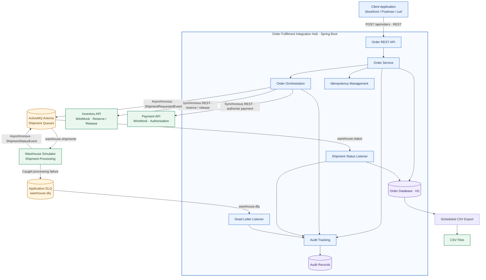
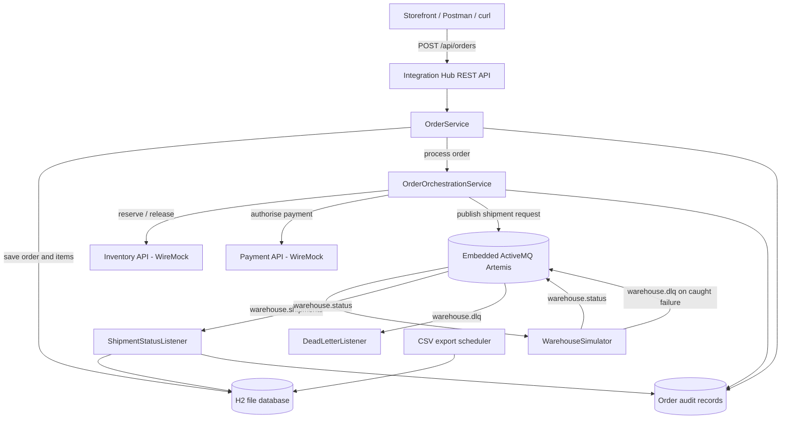
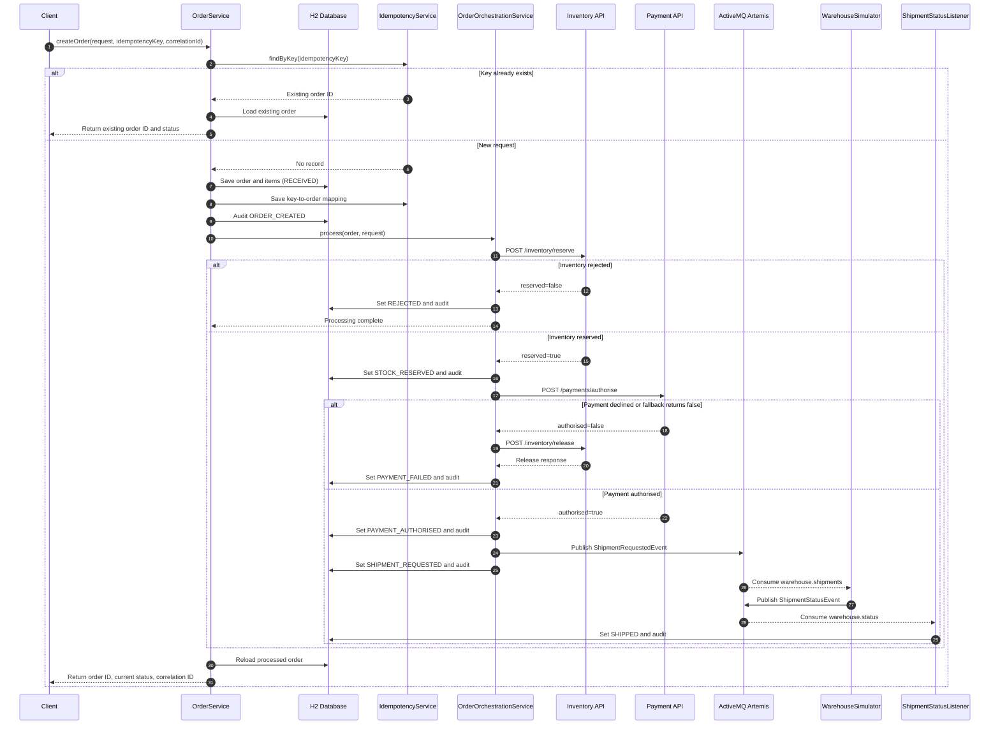
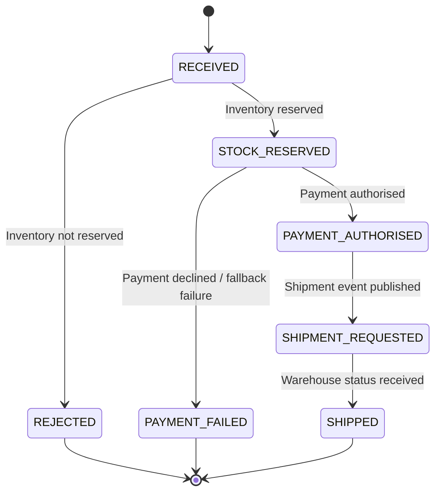
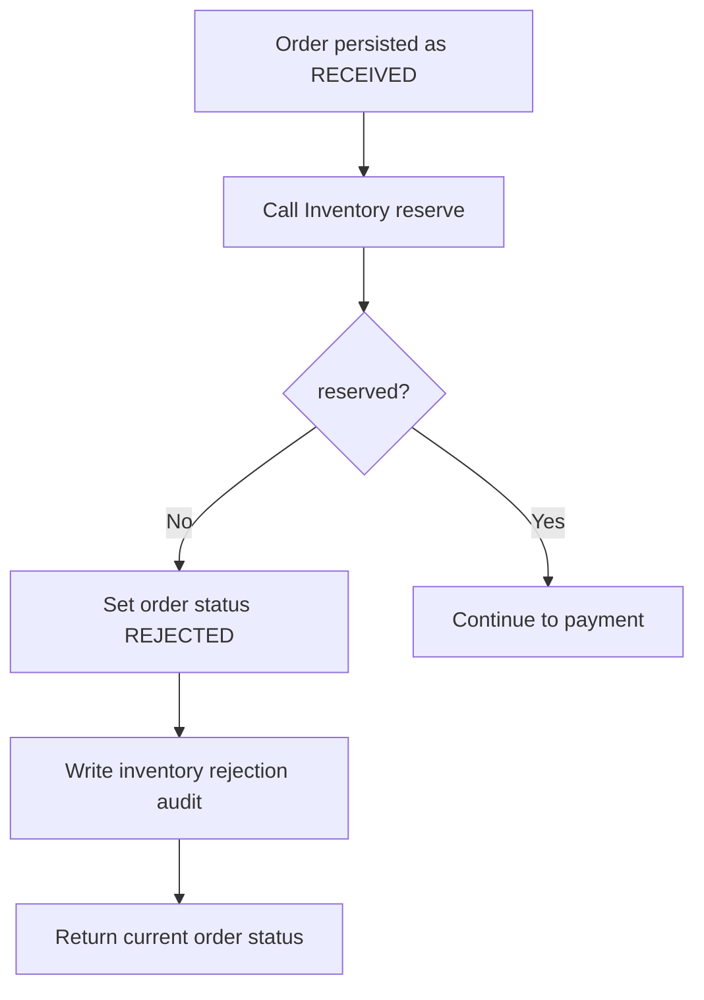
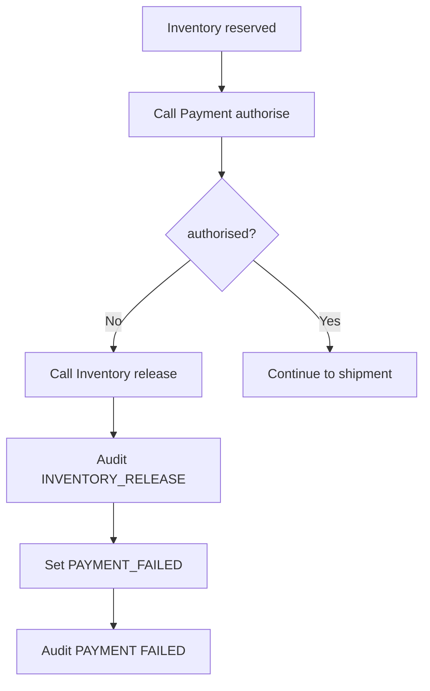

# Order Fulfilment Integration Hub

A Spring Boot application that coordinates order fulfilment across independently simulated Inventory, Payment, and Warehouse systems. It demonstrates synchronous REST orchestration, asynchronous shipment messaging, Saga-style compensation, idempotency, audit tracking, resilience controls, and operational endpoints.

> **Implementation note:** This README distinguishes behavior visible in the source code shared so far from requirements described in the original POC. The controller, security/correlation filters, JMS broker configuration, and CSV exporter implementation have not yet been shared, so those details are identified as configuration or verification points rather than assumed to be complete.

## Contents

- [Overview](#overview)
- [Technology stack](#technology-stack)
- [Architecture](#architecture)
- [Order processing flow](#order-processing-flow)
- [Order lifecycle](#order-lifecycle)
- [Failure and compensation scenarios](#failure-and-compensation-scenarios)
- [Messaging and dead-letter handling](#messaging-and-dead-letter-handling)
- [Idempotency and audit trail](#idempotency-and-audit-trail)
- [Configuration](#configuration)
- [Prerequisites](#prerequisites)
- [Run locally](#run-locally)
- [API usage](#api-usage)
- [WireMock scenarios](#wiremock-scenarios)
- [Operational endpoints](#operational-endpoints)
- [CSV export](#csv-export)
- [Database schema](#database-schema)
- [Testing](#testing)
- [Implementation notes and known gaps](#implementation-notes-and-known-gaps)
- [Repository](#repository)

## Overview

The Integration Hub acts as the orchestration layer between a retail storefront and downstream fulfilment capabilities.

For each new order, the application:

1. Persists the order and its line items.
2. Reserves inventory through a REST call.
3. Authorises payment through a REST call protected by Resilience4j retry and circuit-breaker policies.
4. Releases reserved inventory if payment is declined or the payment call falls back to a failure response.
5. Publishes a shipment request to an embedded ActiveMQ Artemis queue after successful payment.
6. Receives shipment status asynchronously and updates the order.
7. Records processing milestones in an audit table.

The downstream Inventory and Payment APIs are simulated using WireMock. The Warehouse is simulated by a JMS listener in the application.

## Technology stack

| Technology | Version / configuration |
|---|---|
| Java | 21 |
| Spring Boot | 3.5.6 |
| Build | Maven |
| REST client | Spring `RestClient` |
| Database | H2, file mode, PostgreSQL compatibility |
| Persistence | Spring Data JPA / Hibernate |
| Schema migration | Flyway |
| Messaging | Embedded ActiveMQ Artemis |
| Downstream simulation | WireMock 3.9.1 standalone |
| Resilience | Resilience4j 2.2.0 |
| API documentation | Springdoc OpenAPI 2.8.9 |
| Monitoring | Spring Boot Actuator |
| Test support | Spring Boot Test, Awaitility, WireMock, JaCoCo |

## Architecture

### High-level architecture

The diagram below shows the main systems and how an order moves through the Integration Hub. Solid REST interactions are synchronous; the shipment request and shipment status interactions are asynchronous JMS messages.



**Communication patterns**

- **Synchronous:** The Integration Hub calls the Inventory and Payment APIs over REST and waits for their responses.
- **Asynchronous:** After successful payment, the hub publishes a shipment request to ActiveMQ Artemis. The Warehouse Simulator processes it and publishes a shipment status event.
- **Failure handling:** The Warehouse Simulator routes caught processing failures to the application-managed `warehouse.dlq` queue, where the dead-letter listener records an audit entry.
- **Persistence and reporting:** Order and audit information is stored in H2. The scheduled export process reads eligible orders and writes CSV files; the exporter implementation and schedule remain subject to the verification note below.

### Implementation-level component architecture

The following diagram shows the application classes and persistence interactions at a more detailed level.



### Component responsibilities

| Component | Responsibility |
|---|---|
| `OrderService` | Checks the idempotency key, creates and persists the order and items, starts orchestration, and builds the create-order response. |
| `OrderOrchestrationService` | Coordinates inventory reservation, payment authorisation, compensation, and shipment publication. |
| `InventoryClient` | Calls the Inventory reserve and release endpoints using `RestClient`. |
| `PaymentClient` | Calls the Payment authorisation endpoint using `RestClient`, with Resilience4j retry and circuit-breaker annotations. |
| `IdempotencyService` | Stores and retrieves the order associated with an idempotency key. |
| `AuditService` | Writes processing step, outcome, supplied correlation value, and timestamp to `order_audit`. |
| `ShipmentPublisher` | Publishes shipment requests and application-routed failure messages to Artemis queues. |
| `WarehouseSimulator` | Consumes shipment requests, simulates processing, and publishes a shipment status or a message to the application DLQ queue. |
| `ShipmentStatusListener` | Consumes shipment status messages and marks the corresponding order as `SHIPPED`. |
| `DeadLetterListener` | Consumes messages from `warehouse.dlq` and records a DLQ audit entry. |

## Order processing flow

The order creation and downstream REST calls are synchronous in the shared implementation. Shipment processing is asynchronous because it is handed to Artemis and handled by a JMS listener.



### Step-by-step behavior

1. **Receive and de-duplicate the request.** `OrderService.createOrder` first looks up the supplied idempotency key. If it already exists, the associated order is loaded and returned; the downstream workflow is not started again.
2. **Create the order.** For a new key, the service generates an order ID, creates an order with status `RECEIVED`, attaches the requested items, and saves it.
3. **Record the request.** The idempotency mapping and an `ORDER_CREATED` audit entry are saved.
4. **Reserve stock.** `InventoryClient.reserve` sends the order ID and requested items to `POST /inventory/reserve`.
5. **Handle inventory rejection.** If the response has `reserved=false`, the order becomes `REJECTED`; an inventory rejection audit entry is written and payment is not called.
6. **Authorise payment.** If inventory is reserved, the order becomes `STOCK_RESERVED`. `PaymentClient.authorise` sends the order ID, customer ID, and total amount to `POST /payments/authorise`.
7. **Compensate on payment failure.** If payment is not authorised, the orchestration service calls `POST /inventory/release`, records the release, and marks the order `PAYMENT_FAILED`.
8. **Request shipment.** If payment succeeds, the order becomes `PAYMENT_AUTHORISED`. A `ShipmentRequestedEvent` containing the order ID, customer ID, and correlation ID is published to `warehouse.shipments`; the order then becomes `SHIPMENT_REQUESTED`.
9. **Complete asynchronously.** The warehouse simulator consumes the event and publishes a `ShipmentStatusEvent` to `warehouse.status`. The status listener updates the order to `SHIPPED`.

The create-order service reloads the order after orchestration and returns its current status. Since the warehouse response is asynchronous, the immediate response will normally be `SHIPMENT_REQUESTED`, not `SHIPPED`. Use the order lookup endpoint to check for the later status.

## Order lifecycle



| Status | Meaning |
|---|---|
| `RECEIVED` | The order has been accepted by the service and persisted. |
| `STOCK_RESERVED` | Inventory confirmed the reservation. |
| `REJECTED` | Inventory could not reserve the requested stock. |
| `PAYMENT_AUTHORISED` | Payment authorisation succeeded. |
| `PAYMENT_FAILED` | Payment was declined or the payment client returned its failure fallback. |
| `SHIPMENT_REQUESTED` | The shipment request was published to the warehouse queue. |
| `SHIPPED` | A shipment status event was consumed and the order was updated. |

## Failure and compensation scenarios

### 1. Insufficient inventory



The implementation checks `InventoryResponse.reserved()`. When it is false, it saves `REJECTED`, writes an audit record, and returns from orchestration without calling Payment.

### 2. Payment decline or payment fallback



This is a Saga-style compensating action: the application does not attempt a distributed database transaction across Inventory and Payment. Instead, it invokes the Inventory release operation when payment does not succeed.

### 3. Payment timeout / downstream exception

`PaymentClient.authorise` is annotated with both `@Retry` and `@CircuitBreaker`, each using the `payment` instance and the `paymentFallback` method. The fallback returns `PaymentResponse(false, null)`. The orchestration service then follows its normal payment-failure path and attempts to release inventory.

The supplied WireMock slow mapping delays the response by 15 seconds for `CUST-SLOW`. The exact timeout behavior depends on the `RestClient` request-factory/connect/read-timeout configuration, which was not included in the shared configuration. The `resilience4j.timelimiter` YAML property alone does not prove that a synchronous `RestClient` call is being time-limited; no `@TimeLimiter` annotation is present in the supplied `PaymentClient`.

### 4. Warehouse processing failure

The warehouse simulator checks for customer ID `CUST-WAREHOUSE-FAIL`. It throws a simulated exception, catches it, and explicitly publishes the original shipment event to `warehouse.dlq`. The `DeadLetterListener` consumes that queue and writes a `DLQ / RECEIVED` audit record.

This is application-level DLQ routing in the shared code. It is not evidence of Artemis broker-managed redelivery or a broker dead-letter address policy.

## Messaging and dead-letter handling

The shared code uses these queue names:

| Queue | Direction | Purpose |
|---|---|---|
| `warehouse.shipments` | Hub → Warehouse simulator | Carries `ShipmentRequestedEvent`. |
| `warehouse.status` | Warehouse simulator → Hub | Carries `ShipmentStatusEvent`. |
| `warehouse.dlq` | Warehouse simulator → DLQ listener | Carries shipment events that the simulator could not process. |

The publisher uses `JmsTemplate.convertAndSend`. The warehouse simulator listens on `warehouse.shipments`; after its simulated processing delay, it sends a status event to `warehouse.status`. The status listener updates the order.

## Idempotency and audit trail

### Idempotency

The `IdempotencyService` stores a mapping from `Idempotency-Key` to order ID in `idempotency_record`.

- A first request creates the order and saves the key mapping.
- A repeated request with the same key loads and returns the original order.
- The repeated request does not run inventory, payment, or shipment orchestration again.

The current implementation uses a lookup followed by a save. For concurrent requests using the same new key, a database uniqueness constraint and appropriate conflict handling should be considered to guarantee race-safe idempotency.

### Audit trail

The `AuditService` persists an audit row containing:

- Order ID
- Processing step
- Outcome
- Supplied correlation value
- Creation timestamp

Examples of steps written by the shared code include `ORDER_CREATED`, `INVENTORY`, `PAYMENT`, `INVENTORY_RELEASE`, `SHIPMENT`, and `DLQ`.

> **Correlation field verification:** In the pasted code, calls to `AuditService.audit` pass values such as `LOCAL` and `ARTEMIS` as the fourth argument, even though that argument is stored in a field named `correlationId`. These values currently identify the processing source rather than the request's actual correlation ID. The README therefore does not claim that the real correlation ID is propagated to every audit record or outbound request.

## Configuration

The shared `application.yml` contains the following important settings:

| Property | Value | Purpose |
|---|---|---|
| `spring.datasource.url` | `jdbc:h2:file:./data/orderdb;MODE=PostgreSQL` | Persistent local H2 database. |
| `spring.jpa.hibernate.ddl-auto` | `validate` | Hibernate validates the schema rather than generating it. |
| `spring.flyway.enabled` | `true` | Enables Flyway migrations. |
| `spring.artemis.mode` | `embedded` | Uses an embedded Artemis broker. |
| `hub.inventory-url` | `http://localhost:8089` | Inventory WireMock base URL. |
| `hub.payment-url` | `http://localhost:8089` | Payment WireMock base URL. |
| `hub.api-key` | `${HUB_API_KEY:local-dev-key}` | API key property with a local default. |
| `resilience4j.retry.instances.payment.max-attempts` | `3` | Configured maximum payment attempts. |
| `resilience4j.retry.instances.payment.wait-duration` | `1s` | Configured wait between retry attempts. |
| `resilience4j.circuitbreaker.instances.payment.sliding-window-size` | `5` | Circuit-breaker sliding window size. |
| `resilience4j.circuitbreaker.instances.payment.minimum-number-of-calls` | `3` | Minimum calls before failure-rate evaluation. |
| `resilience4j.circuitbreaker.instances.payment.failure-rate-threshold` | `50` | Configured failure-rate threshold. |
| `resilience4j.circuitbreaker.instances.payment.wait-duration-in-open-state` | `30s` | Time before the circuit breaker may move from open state. |

The POC describes local, warehouse, and test profiles, a three-second payment time limiter, outbound correlation propagation, and environment-specific configuration. Those profile-specific implementations were not present in the files shared so far.

## Prerequisites

Install the following:

- JDK 21
- Maven 3.9 or later
- Git
- WireMock standalone 3.9.1 JAR
- Postman, curl, or an IDE HTTP client (optional, for API testing)

Verify the installations:

```bash
java -version
mvn -version
git --version
```

## Run locally

### 1. Clone the repository

```bash
git clone https://github.com/manoj0708r/integration-hub.git
cd integration-hub
```

### 2. Start WireMock

Download the WireMock standalone 3.9.1 JAR and run it from the repository root:

```bash
java -jar wiremock-standalone-3.9.1.jar \
  --port 8089 \
  --root-dir ./wiremock
```

WireMock should be available at:

```text
http://localhost:8089
```

The mappings under `wiremock/mappings` simulate Inventory and Payment responses.

### 3. Start the Integration Hub

In a second terminal, from the project root:

```bash
mvn clean spring-boot:run
```

The application is expected to start at:

```text
http://localhost:8080
```

### 4. Open the developer consoles

| Resource | URL |
|---|---|
| Swagger UI | http://localhost:8080/swagger-ui/index.html |
| H2 Console | http://localhost:8080/h2-console |
| Actuator health | http://localhost:8080/actuator/health |
| Actuator metrics | http://localhost:8080/actuator/metrics |
| Actuator circuit breakers | http://localhost:8080/actuator/circuitbreakers |

H2 console connection details:

```text
JDBC URL: jdbc:h2:file:./data/orderdb;MODE=PostgreSQL
Username: sa
Password: (empty)
```

## API usage

The POC defines these API operations:

| Method | Endpoint | Purpose |
|---|---|---|
| `POST` | `/api/orders` | Submit an order for processing. |
| `GET` | `/api/orders/{id}` | Retrieve the order and its audit history. |

The controller source has not yet been shared, so confirm the exact response status codes and header enforcement in the controller/filter implementation.

### Create an order

Example request based on the DTO fields used by the shared service:

```http
POST http://localhost:8080/api/orders
Content-Type: application/json
X-API-Key: local-dev-key
Idempotency-Key: HAPPY-001
X-Correlation-Id: CORR-HAPPY-001
```

```json
{
  "customerId": "CUST-1001",
  "items": [
    {
      "sku": "SKU-IPHONE-16",
      "quantity": 1,
      "unitPrice": 85000
    }
  ],
  "totalAmount": 85000,
  "currency": "INR"
}
```

The service response is constructed from the persisted order after the synchronous inventory/payment orchestration has completed. For a successful payment, the response will generally show `SHIPMENT_REQUESTED`; the asynchronous warehouse listener later changes it to `SHIPPED`.

Required headers according to the project usage described so far:

| Header | Purpose |
|---|---|
| `X-API-Key` | API key value; the configured local value is `local-dev-key`. |
| `Idempotency-Key` | Identifies a request so a retry can return the original order. |
| `X-Correlation-Id` | Optional correlation identifier supplied to the service, if the API layer supports it. |

The API-key filter and correlation-ID filter were not included in the pasted source. Header enforcement and automatic correlation-ID generation should be verified against those classes.

### Retrieve an order

```http
GET http://localhost:8080/api/orders/{orderId}
X-API-Key: local-dev-key
```

The shared `OrderService.getOrder` implementation returns the order ID, customer ID, current status, and audit entries ordered by creation time.

## WireMock scenarios

The supplied mappings use request-body matching to select the simulated response.

| Scenario | Trigger | Simulated behavior |
|---|---|---|
| Inventory success | Any normal `/inventory/reserve` request not matched by the higher-priority rejection mapping | Returns `reserved: true`. |
| Inventory rejection | Request body contains `SKU-OUT-OF-STOCK` | Returns `reserved: false`; order becomes `REJECTED`. |
| Inventory release | `POST /inventory/release` | Returns HTTP 200. |
| Payment success | Normal `/payments/authorise` request | Returns `authorised: true`. |
| Payment decline | Request body contains `CUST-FAIL` | Returns `authorised: false`; the hub attempts inventory release and sets `PAYMENT_FAILED`. |
| Slow payment | Request body contains `CUST-SLOW` | Delays the response by 15 seconds. Actual timeout behavior depends on the configured HTTP client timeout. |

### Scenario A: Happy path

Use `CUST-1001` and an available SKU such as `SKU-IPHONE-16`.

Expected order progression:

```text
RECEIVED
  -> STOCK_RESERVED
  -> PAYMENT_AUTHORISED
  -> SHIPMENT_REQUESTED
  -> SHIPPED
```

The final transition is asynchronous. Query the order after the warehouse listener has processed the status message.

### Scenario B: Inventory rejection

Use SKU `SKU-OUT-OF-STOCK`.

Expected result:

```text
RECEIVED -> REJECTED
```

Payment authorisation should not be called.

### Scenario C: Payment decline and compensation

Use customer ID `CUST-FAIL` with an SKU that can be reserved.

Expected result:

```text
RECEIVED
  -> STOCK_RESERVED
  -> INVENTORY_RELEASE
  -> PAYMENT_FAILED
```

The audit trail should contain the inventory release and payment failure steps.

### Scenario D: Slow payment

Use customer ID `CUST-SLOW`.

WireMock waits 15 seconds before responding. The configured retry and circuit-breaker behavior can be observed if the HTTP client times out or otherwise reports failures. Verify the actual `RestClient` timeout configuration before expecting a timeout at a particular duration.

### Scenario E: Warehouse failure and DLQ

Use customer ID `CUST-WAREHOUSE-FAIL` with successful inventory and payment data.

Expected behavior in the supplied simulator:

1. The order reaches `SHIPMENT_REQUESTED`.
2. `WarehouseSimulator` detects the special customer ID and simulates a processing exception.
3. The simulator catches the exception and publishes the shipment event to `warehouse.dlq`.
4. `DeadLetterListener` consumes the message and writes a `DLQ / RECEIVED` audit entry.

The shared code does not change the order status from `SHIPMENT_REQUESTED` to a warehouse-failure status.

## Operational endpoints

The shared configuration exposes Actuator web endpoints using:

```yaml
management:
  endpoints:
    web:
      exposure:
        include: "*"
```

Useful endpoints include:

| Endpoint | Purpose |
|---|---|
| `/actuator/health` | Application health information. |
| `/actuator/metrics` | Available application metrics. |
| `/actuator/circuitbreakers` | Circuit-breaker information, if the corresponding Actuator integration is registered. |

For a deployed environment, avoid exposing all Actuator endpoints publicly. Restrict access and expose only the endpoints required by operators.

## CSV export

The project description includes a scheduled CSV export for orders that have not yet been exported. The `orders` table includes an `exported` flag, and the original project overview describes exported files being written to an `exports/` directory.

The scheduler/exporter Java implementation and its cron configuration have not yet been shared. Therefore, the exact selection criteria, output filename, export directory, schedule, and update transaction should be confirmed from that code before treating them as verified behavior.

## Database schema

Flyway manages the schema. Hibernate is configured with `ddl-auto: validate`, so the application expects the database schema to be created by migrations.

| Table | Purpose |
|---|---|
| `orders` | Order header, customer, amount, currency, status, correlation ID, timestamps, and export flag. |
| `order_items` | SKU, quantity, unit price, and owning order. |
| `order_audit` | Processing step, outcome, correlation value, and timestamp. |
| `idempotency_record` | Idempotency key mapped to the original order ID. |

The shared migration defines the `orders`, `order_items`, `order_audit`, and `idempotency_record` tables.

## Testing

Run the Maven verification lifecycle:

```bash
mvn clean verify
```

The POC calls for unit, integration, web-layer, and asynchronous tests using JUnit 5, Mockito, Spring Boot Test, WireMock, and Awaitility, with JaCoCo coverage reporting.

The `pom.xml` shared so far includes those test dependencies and a JaCoCo report execution. The test classes and actual coverage results have not yet been provided, so no coverage percentage or complete test-suite result is claimed here.

Recommended scenarios to cover:

- Successful order processing through `SHIPMENT_REQUESTED` and asynchronous `SHIPPED`.
- Insufficient inventory rejects the order and does not call Payment.
- Payment decline invokes inventory release and records `PAYMENT_FAILED`.
- Payment timeout/failure exercises retry, circuit breaker, fallback, and compensation.
- Repeated POST with the same idempotency key returns the existing order.
- Warehouse processing failure routes the event to `warehouse.dlq` and records a DLQ audit entry.
- Order lookup returns the current status and ordered audit history.

## Implementation notes and known gaps

The original POC describes a broader target design than can be confirmed from the source snippets supplied so far. The following points are worth validating before presenting this as a fully production-like implementation:

1. **HTTP timeout / TimeLimiter:** The shared `PaymentClient` has `@Retry` and `@CircuitBreaker`, but no `@TimeLimiter`. The YAML contains a TimeLimiter duration, but the shown synchronous `RestClient` call does not by itself demonstrate that the setting is applied. Confirm the configured request factory and timeouts.
2. **Inventory resilience:** The POC asks for Inventory retry, but the shared `InventoryClient` has no retry annotation.
3. **Broker-managed DLQ and redelivery:** The shared warehouse listener catches processing exceptions and sends the event to `warehouse.dlq` itself. Broker redelivery attempts and broker DLQ policy are not shown.
4. **Idempotent shipment consumer:** The status listener always sets the order to `SHIPPED`; it does not currently check whether the order is already shipped before processing a duplicate status.
5. **Correlation propagation:** The audit method's fourth parameter is stored as `correlationId`, but callers currently pass labels such as `LOCAL` and `ARTEMIS`. Outbound REST/JMS correlation propagation and MDC logging are not shown.
6. **Warehouse profile:** The shared `WarehouseSimulator` has no `@Profile` annotation, so it appears to be registered whenever component scanning includes it. The POC's separate `warehouse` profile is not demonstrated.
7. **API security and Problem Details:** The POC calls for API-key validation and RFC 7807 error responses. The filter, exception advice, and controller were not part of the shared code.
8. **CSV export:** The exporter and scheduler implementation were not supplied, so export behavior remains to be verified.
9. **Transaction boundaries:** `OrderService.createOrder` and `OrderOrchestrationService.process` are transactional. The REST calls to downstream systems are not part of the local database transaction; a database rollback cannot automatically undo an already completed remote reservation or payment action. Compensation is therefore an important part of the workflow.
10. **Shipment status payload:** The current listener sets the status to `SHIPPED` without checking the status value in the event. If more warehouse outcomes are introduced, map and validate those explicitly.

These notes are intentional: they make the documentation reflect the code that exists, while clearly showing where the implementation can be extended to meet the complete POC specification.

## Repository

GitHub: https://github.com/manoj0708r/integration-hub
