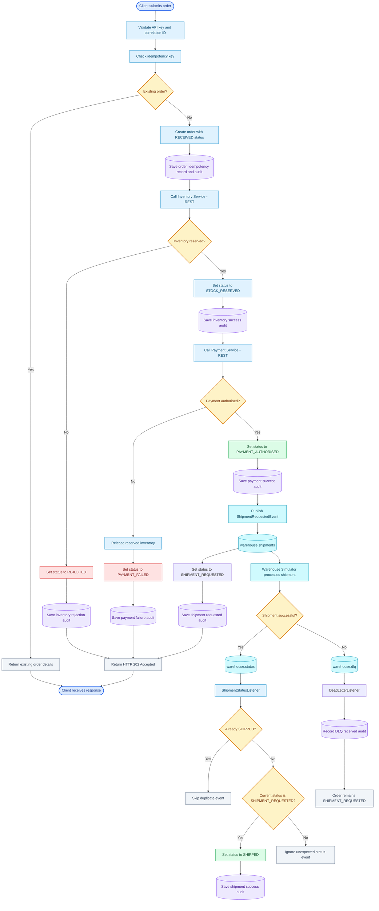
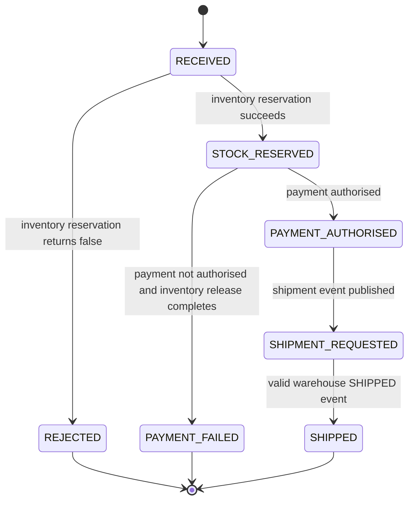

# Order Fulfilment Integration Hub --- Design Note

**Document purpose.** This note describes the supplied POC
implementation, explains its architectural trade-offs, and identifies
the changes recommended before production deployment. The POC is a
runnable integration demonstration; it should not be represented as
production-ready without the hardening work in Section 5.

## 1. Architecture and order-flow sequence

The Integration Hub owns the order lifecycle and orchestrates Inventory and Payment through synchronous REST calls. Warehouse fulfilment is asynchronous and uses JMS messaging.

H2 with Flyway persists orders, idempotency records, and audit entries. WireMock simulates downstream REST dependencies, while the Warehouse Simulator consumes shipment requests and publishes shipment status events.

### Order processing flow

The following diagram illustrates the complete order lifecycle, from the initial client request through inventory reservation, payment authorization, shipment processing, and final order status updates.

### Request and response semantics

`OrderService.createOrder()` invokes `OrderOrchestrationService.process()` before returning the response. Therefore, inventory reservation and payment authorization are performed synchronously as part of the create-order request.

The controller returns HTTP `202 Accepted` after the synchronous orchestration completes. Warehouse processing happens asynchronously through JMS, and the final `SHIPPED` status is set by `ShipmentStatusListener` when a valid shipment status event is received.

The HTTP 202 response therefore indicates that the order workflow has been accepted and shipment has been requested; it does not mean that the warehouse has completed shipment.

### Important implementation behavior

- **Idempotency:** A repeated idempotency key returns the existing order instead of creating another order.
- **Inventory rejection:** The order moves to `REJECTED` if inventory reservation fails.
- **Payment failure:** The application attempts to release reserved inventory before setting the order to `PAYMENT_FAILED`.
- **Shipment success:** A valid warehouse status event moves the order to `SHIPPED`. Duplicate SHIPPED events are skipped.
- **Dead-letter handling:** Warehouse failures are sent to `warehouse.dlq`. The `DeadLetterListener` records a DLQ audit entry; it does not automatically retry the shipment or change the order status.

## 2. Implemented order state machine

The following states are the exact values in the supplied `OrderStatus`
enum. `RECEIVED` is persisted when the order is created; the remaining
transitions are made by the orchestration and shipment-status listener.

**Important boundary:** `DLQ` is not an `OrderStatus`. The Warehouse
Simulator catches a processing exception and publishes the
`ShipmentRequestedEvent` to `warehouse.dlq`; `DeadLetterListener`
records an audit entry with step `DLQ` and outcome `RECEIVED`. The shown
code does not change the order from `SHIPMENT_REQUESTED` when this
happens. Likewise, the enum does not contain a compensation-in-progress
or compensation-failed state.

The shown payment-decline path records `PAYMENT_FAILED` only after
`inventoryClient.release()` returns. If release throws, execution exits
before that status update and before the subsequent payment-failure
audit. That recovery gap should be handled explicitly before production
(for example, with a compensation-pending state, durable
retry/reconciliation and alerting).

## 3. Key design decisions and trade-offs

The Integration Hub uses different integration patterns depending on the response time, consistency, and reliability requirements of each downstream interaction. The following table summarizes the POC decisions and the recommended evolution for production.

| Concern | POC decision and reason | Production trade-off / recommended evolution |
|---|---|---|
| **Synchronous REST vs asynchronous JMS** | Inventory reservation and Payment authorization use synchronous REST because each result determines whether order orchestration can proceed. Warehouse shipment uses asynchronous JMS because fulfilment can complete independently after the order request. | REST provides immediate decisions but adds latency and runtime dependency on downstream availability. Messaging decouples processing and supports buffering, but introduces eventual consistency, duplicate delivery, ordering, and replay concerns. |
| **Saga compensation vs distributed transaction** | The Hub coordinates the workflow. If payment is not authorised after stock is reserved, it calls Inventory release as a compensating business action. | This avoids requiring a distributed ACID transaction or two-phase commit across independently owned services. Compensation is not a database rollback: it can fail or have an uncertain outcome. Production requires durable tracking, retries, idempotency, and reconciliation. |
| **Database and broker** | H2 and Flyway, together with an embedded broker, make the POC simple to start and repeat locally. WireMock provides controllable Inventory and Payment responses, while the in-process Warehouse Simulator exercises JMS request, status, and dead-letter flows. | Use managed PostgreSQL and a production-grade external broker. Validate migrations and integration tests against the target PostgreSQL version. Configure high availability, backups, access control, TLS, connection pooling, broker durability, monitoring, retention, and disaster recovery. |
| **Resilience and timeouts** | The shared `RestClient` configuration uses a 3-second connection timeout and a 5-second read timeout. The Payment client is configured with Resilience4j retry and circuit-breaker behavior. | Define per-operation timeouts and bounded retries with backoff and jitter. Retry only transient failures. Ensure Payment and Inventory operations are idempotent or protected by stable request keys. Define how open circuits, exhausted retries, fallback behavior, and ambiguous timeouts are surfaced and reconciled. |
| **Idempotency and traceability** | `Idempotency-Key` is stored with the order ID and checked before creating a new order. `X-Correlation-Id` is accepted or generated by the application, stored with the order, added to the logging MDC context, returned in API responses, and recorded in audit entries to support request tracing across the order lifecycle. Duplicate shipment confirmation is skipped when the order is already `SHIPPED`. | Retain the database primary-key uniqueness constraint and handle concurrent duplicate requests atomically. Define key scope, expiry/retention, and payload-mismatch behavior. Propagate correlation and trace context across REST and JMS, and use durable deduplication for all event consumers. |

## 4. Transactional Outbox: the publication gap

The current flow performs database updates and JMS publication as separate operations. Although `OrderService.createOrder()` is transactional, the supplied implementation does not demonstrate a single atomic transaction covering both the database and message broker.

The shipment event is published before the order status is updated to `SHIPMENT_REQUESTED`. If publication succeeds but the database transaction subsequently rolls back, the warehouse may receive an event while the order state is not committed. Conversely, failures or uncertain broker outcomes can create inconsistencies between persisted order state and message delivery. This is the dual-write problem.

## 5. Production-readiness gaps and next steps

Before production use:

-   **Transactions and external calls:** The create-order service is
    `@Transactional` while orchestration performs network calls. Avoid
    holding a database transaction open across slow downstream calls.
    Define transaction boundaries around local state changes, and use
    durable workflow/compensation records for recovery.
-   **Compensation recovery:** Persist compensation intent/outcome and
    support retry, alerting and manual reconciliation if Inventory
    release fails. Do not assume a timeout means the remote operation
    did not happen.
-   **Messaging reliability:** Add an Outbox, durable broker
    configuration, explicit delivery/retry policy, poison-message
    handling, DLQ replay procedures and consumer idempotency. The
    current DLQ listener audits receipt; it does not itself retry or
    repair the order.
-   **Warehouse failure visibility:** A DLQ audit currently leaves the
    order status at `SHIPMENT_REQUESTED`. Add an explicit operational
    status or queryable failure indicator and an alert/re-drive process
    if the business requires visibility in the order API.
-   **Security and operations:** Replace the static API-key approach
    with managed credentials or OAuth2/mTLS as appropriate; protect
    operational endpoints and Swagger in production; externalize
    secrets; add authorization, rate limiting, structured logs, metrics,
    distributed tracing and alerting.
-   **Persistence and export:** Validate Flyway migrations on PostgreSQL
    and add indexes/constraints appropriate to production traffic. The
    scheduled CSV exporter is a separate operational export (every two
    minutes); make file delivery, duplicate handling, retention and
    export recovery durable if it becomes a business-critical
    integration.
-   **Testing and deployment:** Add PostgreSQL and real-broker
    integration tests, concurrency tests for idempotency,
    failure-injection tests for publish/compensation gaps, load tests,
    backup/restore tests and deployment/rollback procedures.

## 6. Suggested 30-minute demo

1.  **Architecture and lifecycle --- 5 minutes:** Explain the Hub,
    downstream simulators, exact order states, correlation ID and
    idempotency.
2.  **Happy path --- 8 minutes:** Create an order, show `RECEIVED` →
    `STOCK_RESERVED` → `PAYMENT_AUTHORISED` → `SHIPMENT_REQUESTED`, then
    retrieve it after the warehouse event changes it to `SHIPPED`.
3.  **Fault scenarios --- 12 minutes:** Demonstrate inventory rejection;
    payment failure followed by inventory release and `PAYMENT_FAILED`;
    and warehouse failure routed to `warehouse.dlq` with a
    `DLQ / RECEIVED` audit while the order remains `SHIPMENT_REQUESTED`.
4.  **Design trade-offs --- 5 minutes:** Explain synchronous REST vs
    asynchronous JMS, Saga compensation, resilience settings, the Outbox
    gap and production hardening.

**Conclusion.** The POC demonstrates centralized synchronous
orchestration for decisions that require immediate downstream results,
asynchronous warehouse fulfilment, compensating inventory release,
idempotent order creation, correlation/audit tracking and dead-letter
capture. Its production evolution should prioritize durable event
publication (Outbox), recoverable compensation, explicit failure
visibility, PostgreSQL/external broker operation and end-to-end
observability.
